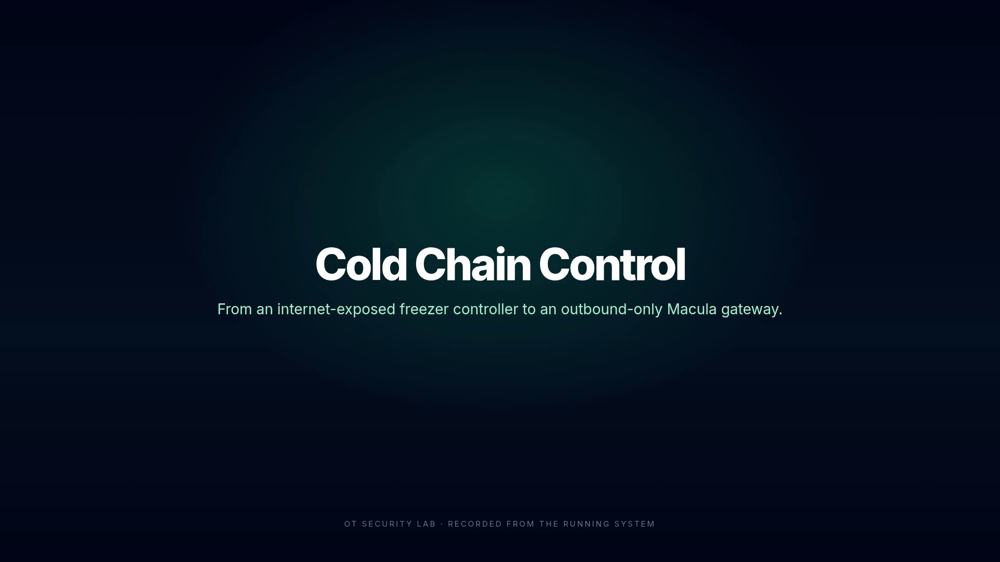

# operational-technology

A lab that shows why an internet-reachable OT controller is a bad idea, and how a Macula
gateway removes the inbound path without changing the controller.

**Status: three slices built.** The as-is attack path works, the mesh read path works, and the mesh
write path works: the dashboard switches from the exposed REST path to a Macula gateway that only
dials out, reads and writes are sealed, writes are authorized by the operator's node identity, and
the gateway refuses replayed commands and unlisted callers.

## What runs today

- **Mock as-is controller** — four simulated freezers, an HTTP/REST surface, open reads, a shared
  `admin/admin` write account, and a simple audit log.
- **Legacy edge** — nginx on ports 80 and 443, the stand-in for the shop's port forward or vendor
  remote-management module.
- **Attacker** — nmap/curl/jq on a simulated internet network. Scans the edge, reads without
  credentials, and takes control with the default account.
- **Phoenix admin dashboard** — the same freezer view in two modes. Legacy mode speaks REST to the
  exposed controller; Mesh mode is a Macula citizen and calls the gateway for reads and writes.
- **Macula station** — a local, single-station island. No public fleet is needed.
- **Realm fixture** — a lab-only stand-in for `macula-realm`. It mints the realm/org keys, publishes
  the signed D25 `org_directory` and `procedure_delegation` records the gateway needs, and answers
  the gateway's boot claim with a delegation for the verified caller.
- **OT gateway** — an `mcl-om` service. It dials out to the station, accepts no inbound connection
  from the mesh or OT network (its BEAM control ports bind to loopback), and exposes typed `ot/*`
  capabilities for reads and writes. It calls the controller's REST API over the OT network with its
  own strong account, never the legacy `admin/admin` default.

## Quick start

Full lab (as-is attack plus mesh read and write paths):

```bash
./scripts/mesh-demo.sh
```

The first run pulls the station image, builds the gateway and realm fixture (the Macula NIFs are
compiled in the builder), builds the dashboard, and waits for the station, realm, gateway, and UI
to settle. Then open <http://localhost:4000>.

As-is attack only:

```bash
./scripts/demo.sh
```

## Demo video

[](assets/demo.mp4)

A 96-second silent walkthrough of the running lab, with captions. It covers the legacy attack, the
retrofit, the post-retrofit scan, the mesh read path, an operator write, and the replay and stranger
refusals.

- [assets/demo.mp4](assets/demo.mp4)
- [assets/demo-poster.png](assets/demo-poster.png)

## The retrofit demonstration

This is the sequence that matters:

1. Open the dashboard at <http://localhost:4000>. It starts in **Legacy** mode.
2. Run the attack:

   ```bash
   ./scripts/attack.sh
   ```

   FZ-01's target becomes `+50°C`, defrost starts, and the controller audit shows the attacker's
   source address and the shared `admin` account.
3. Stop the port forward:

   ```bash
   ./scripts/stop-legacy-edge.sh
   ```

   The dashboard shows **Path unavailable**. The controller is still running, but it is only on the
   OT network.
4. Click **Mesh** in the dashboard. The same freezers keep updating through the station and the
   gateway. The posture cards change to **no inbound port**, **operator node**, and
   **caller + command id**, and the call report says **sealed**.

5. In Mesh mode, write through the gateway. Use a freezer's preset button (for example **+50**) or
   **Defrost**. The gateway audit table shows the verified operator node, the action, and the
   command id; the controller audit shows only the gateway's own `gateway` account.

6. Click **Replay last command**. The gateway refuses it with `command_replayed`: the command id was
   already used.

7. Click **Try as stranger**. A second node identity on the same station is refused with
   `unauthorized`: the gateway advertises its write procedures only to the operator node.

The controller never moved. The network path did, and the authority moved with it.

Reset the lab at any point with `./scripts/reset.sh`.

## Topology

```text
                    simulated internet
  attacker ───────────────┐
                          ▼
                   ┌─────────────┐
                   │ legacy-edge │  :80/:443  (the as-is port forward)
                   └──────┬──────┘
                          │ ot_net
  admin laptop            ▼
  ┌────────────┐    ┌─────────────┐
  │ Phoenix UI │    │ controller  │── simulated freezers
  │ legacy ────┼───►│ REST API    │
  │ mesh ──┐   │    └──────▲──────┘
  └────────┼───┘           │ HTTP on ot_net
           │         ┌─────┴──────┐
           │         │  gateway   │  mcl-om, no network-facing TCP listener
           │         └─────┬──────┘
           ▼               ▼
        ┌────────────────────────┐
        │   macula station       │  local island, mesh_net
        └────────────────────────┘
                 ▲
                 │ D25 chain + boot claim
        ┌────────┴────────┐
        │  realm fixture  │  lab-only, not macula-realm
        └─────────────────┘
```

| Mode | Path |
|---|---|
| Legacy | browser → local Phoenix legacy transport → legacy-edge :80/:443 → controller REST |
| Mesh | browser → local Phoenix mesh transport → station → gateway → controller REST |

The gateway is dual-homed: outbound QUIC to the station, HTTP to the controller on `ot_net`. The
station is the only component that would be public in a real deployment; the shop's gateway has no
network-facing TCP listener, and the controller has no port outside the OT network.

## What the mesh path proves

Read path:

- The gateway is a real `mcl-om` service with a capability advertisement, a provider grant, and a
  `/health` endpoint on a Unix socket.
- The dashboard's Mesh mode resolves `ot/list_freezers` through the station, dials the gateway, and
  gets the controller's freezer list. The browser still talks only to the local Phoenix app.
- The capability is `confidential => required` with `kem_advertise` enabled, so the call is sealed
  (`sealed: 1` in the call report). The station relays ciphertext. The raw `macula_bridge` cannot
  carry this option; the typed gateway can.
- The legacy edge can be stopped; the mesh path keeps working.

Write path:

- The gateway exposes `ot/set_freezer_target`, `ot/start_freezer_defrost`,
  `ot/stop_freezer_defrost`, and `ot/list_freezer_commands` as separate capabilities. Reads stay
  open; writes and the command audit declare `{callers, {nodes, [OperatorNodeId]}}`.
- The dashboard generates the operator identity at `/data/operator.key`, connects outbound to the
  station, and writes its node id to `/mesh/operator-node-id`. The gateway entrypoint exports that
  id as `OPERATOR_NODE_IDS`; with no operator it advertises no write capabilities at all.
- Every write carries a random command id and a wall-clock timestamp. The gateway's command guard
  remembers accepted ids for two minutes and refuses duplicates as `command_replayed` and stale
  commands as `command_expired`.
- The gateway audit records the wire-verified caller node, the action, the freezer, the command id,
  and the result. The controller's own audit sees only the gateway's `gateway` account, never
  `admin/admin`.
- The dashboard's **Replay last command** probe re-sends the previous id and is refused. The
  **Try as stranger** probe connects a second node identity and is refused with `unauthorized`
  before the handler runs.

## What is still missing

- A realm role or a store-scoped UCAN instead of a static operator-node allowlist, plus dynamic
  revocation. The gateway reads `OPERATOR_NODE_IDS` at boot, so a changed operator requires a
  gateway restart.
- A durable command/dedupe store and a signed command log. The current guard is in memory with a
  two-minute TTL, so it does not survive a gateway restart.
- Signed reading history and an export an auditor can verify without Macula.
- A real protocol adapter (Modbus, BACnet, OPC UA, or a vendor API) behind the same typed shape.
- A real `macula-realm` membership, multi-operator approval, and one real station crossing.
- Optional: the raw `macula_bridge` comparison.

## Repository layout

```text
apps/
  freezer_controller/   Elixir/Bandit mock controller, freezer simulator, REST API, audit log
  admin_ui/             Phoenix LiveView dashboard, legacy and mesh transports
  ot_gateway/           Erlang/mcl-om REST-to-RPC gateway
  ot_realm_fixture/     Erlang/macula lab realm chain + claim responder
deploy/
  compose.yml           The lab topology
  station/config.json   Single-station island config
  legacy-edge/          nginx port forward with a self-signed 443 listener
  attacker/             nmap, curl, jq
scripts/
  mesh-demo.sh          Full lab: station, realm, gateway, UI, legacy stack
  demo.sh               As-is only
  scan.sh               Port scan + unauthenticated read
  scan-after-retrofit.sh  Post-retrofit scan: no controller ports from the internet
  attack.sh             Default-credential target change and defrost
  reset.sh              Reset the freezer simulator
  stop-legacy-edge.sh   The retrofit moment
docs/
  DEMO_SCRIPT.md        Step-by-step run sheet
  WHAT_THIS_PROVES.md   Honest boundaries and what is still missing
assets/
  demo.mp4              Captioned 1080p walkthrough
  demo-poster.png       Poster frame
```

## The controller API

| Method | Path | Auth |
|---|---|---|
| `GET` | `/api/health` | none |
| `GET` | `/api/freezers` | none |
| `GET` | `/api/freezers/:id` | none |
| `GET` | `/api/audit` | none |
| `GET` | `/api/session` | basic |
| `POST` | `/api/freezers/:id/target` | basic |
| `POST` | `/api/freezers/:id/defrost` | basic |
| `POST` | `/api/freezers/:id/stop` | basic |
| `POST` | `/api/reset` | basic |

Accounts come from the environment:

- `LEGACY_ADMIN_USER` / `LEGACY_ADMIN_PASSWORD` — default `admin` / `admin`. This is the as-is
  weakness.
- `GATEWAY_USER` / `GATEWAY_PASSWORD` — a second, stronger credential reserved for the gateway's
  write path. The dashboard never sees it.

## Safety

This is a self-contained container lab. The attacker container has no route to the real internet;
`internet_net` is an internal Docker network. `scripts/scan.sh` only targets Compose service names.
Do not point any of these scripts at real controllers or networks you do not own.

## What this does not prove

It does not model Modbus, BACnet, OPC UA, or a real vendor controller. The realm fixture is a lab
stand-in, not `macula-realm` membership and operator approval. The controller's default account
still exists in the as-is stack on purpose; the gateway uses a separate strong account for writes,
but the legacy `admin/admin` path remains until the port forward and the firmware account are
retired. The operator allowlist and command guard are lab-grade, not a production identity system.
See [docs/WHAT_THIS_PROVES.md](docs/WHAT_THIS_PROVES.md) for the full boundary list.

## License

Apache-2.0. See [LICENSE](LICENSE).
